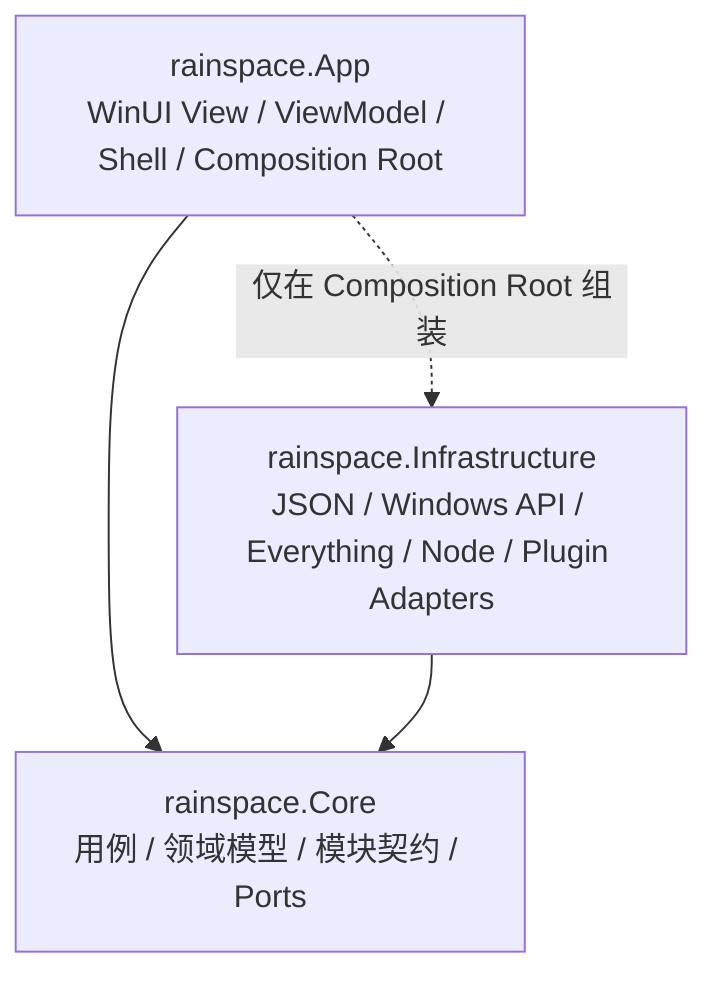
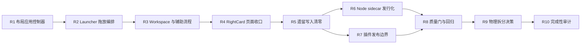

# rainspace 模块化单体优化计划

> 状态：执行中（R4–R10 验收未通过）
> 建立日期：2026-07-16
> 最近更新：2026-07-29
> 当前测试基线：676 项中 655 项通过、21 项失败（x64 Debug）
> `RightCardControl.xaml.cs`：3,257 行

## 1. 计划目标

将 rainspace 渐进式优化为可持续扩展的模块化单体：按 Launcher、Workspace、Search、Appearance、Tray、Settings、ImportExport、Sidecar、Plugins 划分功能边界，采用 Feature-first、MVVM、Ports/Adapters 与轻量 CQRS；优先保证数据安全和单一状态源，再拆分大型 UI 控制器，最后开放受控扩展点。

本计划不要求一次性重写，也不把全部代码机械地拆成三个程序集。每一步都必须保持应用可运行、旧数据可迁移、测试可回归。

当前架构结论：WinUI/.NET 继续作为主应用技术栈；Node.js 适合作为可选 sidecar，承载 JavaScript 生态或需要进程隔离的能力，不适合替代主 UI、托盘、热键、核心领域逻辑和主数据持久化。插件通过受控 manifest、capability 与 contribution 接入，不能直接获得全局可变状态。

## 2. 目标依赖方向



关键约束：

- Core 不引用 WinUI、Windows API、JSON、Everything 或 Node。
- App 不通过静态字段保存业务状态；View 只调用 ViewModel/用例。
- Infrastructure 实现 Core 定义的 Port，不向 Core 暴露具体 SDK 类型。
- 功能模块默认只能依赖其他模块的 Contracts，不直接访问其内部实现。
- 当前先在一个解决方案中形成边界；只有边界稳定后再物理拆分项目。

## 3. 功能模块

| 模块 | 负责 | 对外契约示例 | 不负责 |
|---|---|---|---|
| Launcher | 快捷方式展示、启动、排序、拖放、文件夹 | `ILauncherCommandHandler`、`LauncherShortcutDraft` | 工作区生命周期、Everything SDK |
| Workspace | 工作区、分组、选中状态、跨组移动 | `IWorkspaceCommandHandler`、`IWorkspaceQueryHandler` | 具体 WinUI 控件 |
| Search | 聚合本地快捷方式与搜索提供者 | `ISearchProvider`、`SearchQuery` | 直接调用 Everything 静态工具 |
| Appearance | 背景、主题、图标视觉、布局偏好 | `IAppearanceCommandHandler`、`IAppearanceQueryHandler` | JSON 写盘与窗口句柄操作 |
| Tray | 托盘菜单、全局快捷键、窗口显隐命令 | `ITrayController`、`IHotkeyRegistrar` | 直接修改 Launcher 状态 |
| Settings | 类型化设置、校验、设置页贡献点 | `ISettingsSection` | 任意模块私有数据结构 |
| ImportExport | 备份、导入、SchemaVersion、迁移、校验 | `IBackupService`、`IDataMigration` | UI 文件选择器 |
| Sidecar | Node 进程生命周期、协议、超时、健康检查 | `ISidecarClient` | 核心启动与本地持久化 |
| Plugins | 清单、能力授权、贡献点、启停与隔离 | `IPluginContribution` | 无限制反射和任意全局状态访问 |

## 4. 模块内部结构

新代码优先按功能组织，并在模块内部保持小型分层：

```text
Features/<Module>/
├── Contracts/        # 其他模块允许依赖的 DTO、命令、查询、接口
├── Application/      # 用例、命令处理器、查询处理器
├── Domain/           # 领域模型和纯规则（需要时才建立）
├── Presentation/     # ViewModel、状态映射、UI 命令
└── Infrastructure/   # 仅在尚未物理拆项目的过渡期放适配器
```

轻量 CQRS 只区分“改变状态的命令”和“只读查询”，不引入独立数据库、消息中间件或复杂框架。模块内可直接调用；跨模块使用 Contracts 或少量进程内事件。

## 5. Sidecar 与插件边界

Node sidecar 适合承载 JavaScript 生态、可独立升级或需要崩溃隔离的能力，不承载窗口、托盘、快捷启动和主数据写盘。协议必须具备：

- 明确版本与能力协商；
- request id、超时、取消和结构化错误；
- 心跳、崩溃重启上限和日志关联；
- 输入校验与允许调用的能力白名单；
- sidecar 不直接修改主 JSON，由 App/Core 命令提交变更。

插件先开放受控贡献点：搜索提供者、设置页、Launcher 命令和导入器。第一阶段只支持内置插件；外部插件必须在清单、版本兼容、权限和故障隔离完成后开放。

## 6. 分阶段计划

### P0 数据安全（已完成）

- 修复备份导出读取错误状态源。
- 所有待办变更在服务边界显式保存。
- 删除待办后同步兼容集合，避免旧迁移把任务复活。
- 写盘使用临时文件与原子替换。

### P1 单一状态源与版本化持久化（已完成）

- 已删除 `AppDataStore.Static*` 和模型层 `SaveTrigger`。
- 已建立 `IAppDataProvider` 唯一状态源及状态替换事件。
- 已建立集中式 `AppDataChangeTracker`，兼容尚未改造的直接 UI 绑定。
- 已升级到 `SchemaVersion = 3`，具备顺序迁移、稳定 ID、结构校验和迁移副本回滚。
- 已移除 `MainWindow.appData` 静态兼容入口；全项目通过 `IAppDataProvider` 使用唯一 Store。
- 已用架构测试禁止窗口静态状态桥重新进入应用代码。

### P2 建立模块边界（第一阶段已完成）

- 九个模块均已建立 Feature-first 目录和 Contracts；Infrastructure/Application 按实际需要建立。
- Launcher/Workspace 已有 ID 驱动的命令和查询边界；系统快捷方式添加不再直接写持久化集合。
- 已建立 Search 的 Contracts/Application/Infrastructure/Presentation 链路，Everything 通过 `ISearchProvider` 接入。
- 已建立 ImportExport 的纯 Contracts、事务式备份服务、备份读取器和 WinUI 文件选择适配器。
- 已建立 Settings 的贡献契约、容错目录和页面工厂；三个内置设置页不再读取窗口静态状态。
- Appearance 已提供主题、背景、渐变、颜色和效果的类型化命令/查询；Tray 已提供托盘与热键端口。
- 架构测试已保护 Contracts/Application 不引用 WinUI、ViewModel、Services 或具体基础设施。

### P3 拆分 RightCardControl（执行中）

- 当前 `RightCardControl.xaml.cs` 为 4,122 行；最终将其降为小于 800 行的页面协调器。
- 已将 Launcher 网格布局、快捷方式布局、拖放策略和文件夹资格规则迁入 Application；拖放命中会话、网格整理、可见列表状态、文件夹导航及浮层 ViewModel 归入 Presentation。
- 文件夹浮层的显示、标题、返回状态和内容列表已改为 XAML 绑定，不再由 `RightCard` 手工同步控件。
- 文件夹内拖放的四类分支已由纯 `LauncherFolderDropCommandResolver` 解析为模块命令，`RightCard` 只负责采集 UI 落点和执行结果。
- 批量拖放的原始索引、插入位置、移动节流与重置已归入 `LauncherBatchDragSessionState`；占位块创建、跨组预览、提交、取消回滚和孤儿清理由 `LauncherBatchPlaceholderCoordinator` 事务式编排，并由行为测试和架构守卫保护。
- Launcher 项目 Storyboard 的注册、替换、完成和容器回收清理由 `LauncherItemAnimationCoordinator` 统一管理；批量落位的散射偏移、错峰时间与清理时点由纯 `LauncherBatchDropAnimationPlanner` 计算。
- WinUI 面板原点、坐标转换、容器边界、中心热区和已实现列表落点已集中到 `LauncherDropHitTestAdapter`；图标到稳定网格项的映射由纯 `LauncherShortcutGridItemAdapter` 提供。
- 单图标拖放的当前目标、候选目标和 150ms 稳定门槛已归入 `LauncherSingleIconDragPreviewState`，页面不再保存 pending target/timestamp 裸字段。
- 文件夹拖放的候选、300ms 激活、当前目标与最后有效目标已归入泛型 `LauncherFolderDropIntentState<T>`；指针回退使用纯 `LauncherPointerCacheState`，目标模板查找和缩放/边框动画由 `LauncherDropTargetVisualAdapter` 承担。
- Launcher 图标拖拽预览的唯一宿主、异步截图 generation、防晚到预览和结束置空已由 `LauncherDragPreviewController` 管理；页面不再拥有可空 `DragPreviewHost` 字段。
- 跨分组预览的原选择、目标和异步 token 已归入纯 `LauncherCrossGroupPreviewState`；会话开始/目标切换与目标列表规划由纯 `LauncherCrossGroupPreviewCoordinator` 和 `LauncherCrossGroupPreviewTilePlanner` 组合。预览 `ListView` 的创建替换、虚拟化容器、位图预热、透明度、底层列表显隐、双布局 pass 与 token 校验均归入 `LauncherCrossGroupPreviewOverlayController`。
- 跨分组取消现在由纯完成策略明确区分“不处理、保留批量占位、恢复导航”三条路径，并进一步决定批量项恢复、位置动画和单图标目标重提交；导航恢复显式区分全部分组、活动分组和兜底重建。批量拖拽与跨组预览对图标列表重排的竞争由按原因维护的 `LauncherReorderSuppressionState` 和 WinUI 控制器统一管理，必须释放全部原因后才结束抑制。
- 跨分组预览插入槽的锚点由纯 `LauncherCrossGroupPreviewAnchorSelector` 选择：优先活动宿主中的批量占位符，其次首个拖拽项。`LauncherCrossGroupPreviewPlacementController` 统一解析图标/容器覆盖层坐标，在容器未实现时回退到目标分组标签中心，并负责 token/动画门禁、源容器隐藏和预览落位动画调用。
- 跨分组拖拽结束、完成回调与标签 `Drop` 的目标优先级已归入纯 `LauncherCrossGroupDropPlanner`：拖拽结束优先实时指针，仅在预览活跃且指针仍位于分组栏时回退预览/悬停目标；标签 `Drop` 按直接命中、悬停、预览回退；完成回调只接受活动预览目标。批量占位最终化和预览插入索引也使用同一提交准备规则，三条入口继续共用单一提交方法与应用层移动协调器。
- 跨分组提交后的“全部分组”导航恢复、已捕获顺序应用、列表重建、布局/选择刷新、清理回调和保存时序已由泛型 `LauncherCrossGroupDropViewCoordinator` 统一；标签 `Drop` 与拖拽完成路径不再各自维护一套提交后视图流程。
- 跨组移动的稳定 ID、预览插入位置、命令结果与“全部”视图恢复意图已由 `LauncherCrossGroupMoveCoordinator` 统一处理；拖拽结束、`DragItemsCompleted` 和分组标签 `Drop` 共用单一提交入口，命令失败不再被误报为成功。
- 分组标签与快捷区的坐标转换、边界判断和已实现容器命中已统一委托给 `LauncherDropHitTestAdapter`，页面事件只负责提供当前指针和控件宿主。
- “全部分组”的当前顺序、拖拽开始快照、预览前快照及取消恢复优先级已归入纯 `LauncherAllGroupsOrderState`；页面不再分别维护三个可变列表。
- 分组标签的唯一悬停目标由 `LauncherGroupTabHoverState` 管理，左右边缘自动滚动由纯 `LauncherHorizontalAutoScrollPlanner` 计算；WinUI 命中重试、拖拽视觉、目标标记、预览切换和清理现由泛型 `LauncherGroupBarDragController` 协调，`RightCard` 不再实现这些拖拽机制，暂只保留事件转发、提交和提交后的视图应用。
- 图标选择锚点、Shift 范围、Ctrl 增量、框选指针身份/初始选择基线及拖拽期间的选择视觉快照已归入纯 `LauncherIconSelectionState`；键盘修饰键、虚拟化容器命中、矩形视觉、指针捕获和 `ListView` 选择同步由泛型 `LauncherIconSelectionController` 管理。页面只保留 XAML 事件转发，并修正了增量框选回退时应基于框选开始快照重新计算的行为。
- 单击/双击、添加占位符、文件夹打开与启动意图由 `LauncherIconActivationCoordinator` 分发；普通、管理员和“在资源管理器中显示”统一提交稳定 `IconId` 的 `LauncherActivationCommand`。Application 中的 `LauncherActivationService` 集中处理 800ms 防重与异常结果，`WindowsLauncherActivationPort` 才允许查找 `IconInfo` 并调用 Windows Shell，页面不再直接依赖 `ProcessUtil.StartIconApp`。
- Workspace 分组标签的启用/暂停、拖拽阈值、源/当前/候选索引、移动判定和单次点击抑制已归入纯 `WorkspaceGroupTabDragSessionState`；预览宿主和窗口级指针订阅分别由 Workspace WinUI 控制器管理，并防止异步截图晚到。
- 分组标签的初始插入点和相邻滞回已由纯 `WorkspaceGroupTabInsertPlanner` 计算；容器边界采集、占位宽度、显隐和拖拽/删除 Transition 快照由 Workspace WinUI 适配器统一管理。
- 分组选择指示器的标签解析、更新合并、低优先级布局重试、编辑宽度修正、滚动入视、动画判定、几何缓存和 Storyboard 已归入 `WorkspaceGroupTabSelectionIndicatorController`；标签删除的淡出、缩放、宽度折叠及延迟 Transition 恢复已归入独立删除动画控制器。
- 标签自然宽度和编辑宽度由纯 `WorkspaceGroupTabWidthCalculator` 与 WinUI 测量适配器处理；容器解析、相对宿主边界转换统一进入布局适配器，滚动入视偏移由纯 `WorkspaceGroupTabScrollPlanner` 计算。
- Workspace 分组重命名的目标、原名、焦点建立和失焦提交规则已归入纯 `WorkspaceGroupEditSessionState`；编辑框查找与光标覆盖层由 `WorkspaceGroupEditVisualController` 管理，焦点重试由 `WorkspaceGroupEditFocusScheduler` 调度。切换编辑目标前会先提交旧编辑，避免未提交名称只停留在模型中。
- Workspace 分组集合订阅的替换与释放已归入 `WorkspaceGroupCollectionSubscription`；先行 UI 删除期间的源集合投影抑制由 `WorkspaceGroupTabState` 以可嵌套作用域管理。选中索引到“全部/真实分组”标签的映射由纯 `WorkspaceGroupSelectionProjection` 处理，标签透明 Chrome 由 `WorkspaceGroupTabChromeController` 统一应用。
- Workspace 分组标签容器的回收复位、分阶段材质化、指针处理器装卸、拖拽占位 Chrome、图标几何、自然/编辑宽度及上下文菜单装配已归入 `WorkspaceGroupTabContainerController`；`RightCard` 的 `ContainerContentChanging` 和图标刷新入口只负责转发。
- Workspace 分组及其可替换 `IconList` 的属性/集合监听已归入 `WorkspaceGroupIconCollectionSubscription`；同步活动分组会自动释放已删除分组，替换图标集合会先解除旧集合，页面卸载和状态替换均统一 `DetachAll`，不再由页面维护订阅字典。
- Workspace 分组标签手动拖拽的指针阈值、窗口级捕获、横向滚动暂停/恢复、插入规划、实时集合重排、占位容器、异步预览及提交/中止收尾已合并到 `WorkspaceGroupTabDragCoordinator`；页面卸载会中止会话并恢复未提交顺序，`RightCard` 不再持有拖拽容器、滚动模式或窗口指针状态。
- Workspace 已抽出分组 Tab 状态、稳定 ID 导航状态与旧索引投影适配器；分组与拖放持久化通过模块命令提交。
- 分组选择现在以 `GroupId` 为状态源，重排、删除与跨组拖拽恢复不再依赖易失效的集合索引。
- Launcher 内联添加面板的互斥状态已归入 `LauncherInlineAddPanelState`；系统项/开始菜单的缓存、代次校验、加载取消和大小写无关防抖过滤由 `LauncherInlineSystemItemsCoordinator` 负责。Windows 目录扫描与旧 `IconInfo` 提取只允许出现在 `ILauncherSystemCandidateSource` 的 Infrastructure 实现中，`RightCard` 与独立 `SystemItemWindow` 共用候选源和 Presentation 映射，不再各自递归扫描开始菜单。
- 快捷方式上下文菜单能力已由纯 `LauncherContextMenuPolicy` 按占位项、文件夹、普通快捷方式和文件位置统一判定；`LauncherContextMenuCoordinator` 使用稳定 `IconId` 构造删除、调整文件夹大小和移出文件夹命令，`LauncherContextMenuViewController` 负责 WinUI 菜单显隐、分隔线与子菜单目标投影。普通菜单树的三类写操作由 `AppDataLauncherCommandHandler` 统一变更和请求持久化，All Groups 自有文件夹仍优先走其独立容器语义。
- 快捷方式属性、URL 属性和重命名对话框已改用隔离的 `LauncherShortcutEditDraft`；名称、路径、启动参数、管理员标记和图标只在显式保存时通过 `RenameLauncherShortcutCommand` / `UpdateLauncherShortcutCommand` 一次性提交，图标字节采用防御性复制，取消或仅预览重置不再污染真实 `IconInfo`。URL 新建也改走 `AddLauncherShortcutCommand`，由 Infrastructure 映射 URL 类型并持久化。
- 外部文件拖入现在只由页面读取 `StorageFile.Path` 和目标 `GroupId`；`WindowsLauncherShortcutDraftSource` 负责 `.lnk`、目标路径、启动参数及持久化图标字节解析，且只返回 Contracts 草稿，不构造 `IconInfo`/`BitmapImage`。`LauncherExternalImportService` 汇总部分失败并通过 `AddMany` 单次写入，显式保留原有全分组配置排序语义但只请求一次保存；Presentation 协调器负责取消旧批次和拦截晚到结果。
- 系统候选项点击添加已复用 `LauncherSystemCandidatePresentationMapper.ToDraft`，`SystemItem` UI 不再根据系统参数分支、不再调用 `CommonCode` 重新解析 `.lnk`，也不再构造临时 `IconInfo`；候选源中已解析的名称、路径、参数、链接和图标字节直接进入稳定目标分组 Add 命令。
- Launcher 网格压缩现在先由 `LauncherGridOrganizer.Plan` 生成不修改模型的稳定 ID 位置计划，再由 `UpdateLauncherGridLayoutCommand` 原子更新普通菜单树和 All Groups 自有项；手动落位、文件夹移出后的坐标重置也走同一命令。缺失 ID 会拒绝整批更新，页面不再直接写 `LauncherGridColumn/Row`，由布局触发的直接保存已移除。
- Launcher 顺序持久化已统一进入类型化 `UpdateLauncherShortcutOrderCommand`：普通分组和 All Groups 使用显式作用域，按稳定 ID 原子校验、重排并单次请求保存；All Groups 同时维护各分组相对顺序及平面顺序键，缺失或重复 ID 会在修改前拒绝整批命令。
- All Groups 视图构建已成为无写入副作用的查询；跨组恢复、普通拖拽和 All Groups 投影收尾统一提交 Launcher 命令。`RightCard` 的直接保存调用已从本轮审计初始的 9 处降为 0，且不再直接赋值 `AllGroupsFlatIconOrderKeys`。
- All Groups 自有文件夹的创建、移入和移出已统一提交 `LauncherAllGroupsFolderMutationCommand`；Infrastructure 在任何修改前验证完整、无重复且未过期的稳定 ID 平面快照，并原子维护自有容器与平面顺序键。`RightCard` 不再调用三类自有文件夹写服务。
- JSON/备份读取后会按稳定 `IconId` 将 All Groups 文件夹成员重新关联到 `MenuList` 的唯一对象，避免序列化重载后产生两份可独立修改的快捷方式实例；启动加载和备份导入均执行该规范化。
- All Groups 的稳定/旧版顺序键解析、会话顺序优先级、默认项补齐、隐藏成员过滤和去重已抽入 `LauncherAllGroupsProjectionBuilder`；页面只提供当前数据与可选会话顺序并接收投影，相关代码减少 125 行。
- 图标标题显示现在通过 `IAppearanceQueryHandler` 与 `SetIconTitleVisibilityCommand` 读写，`RightCard` 不再直接修改持久化外观配置；相同值不会重复保存。
- 批量选择模式已从 `AppConfig` 移除，左右面板共享 DI 单例 `LauncherBatchModeState`；`LauncherBatchModeController` 统一处理事件订阅、选择模式切换、启用前清空勾选和重排刷新，左面板也不再通过 `MainWindow.RightCard` 跨控件改 UI。
- 快捷区布局请求的 16ms 合并、动画意图聚合、代次校验、取消和过渡恢复计时已由纯 `LauncherLayoutScheduleState` 与 WinUI `LauncherShortcutLayoutScheduler` 统一；页面不再维护两套计时器和五个调度字段。
- `ItemContainerTransitions` 的保存/禁用/恢复、拖拽让位与重排策略及容器更新时间已归入 `LauncherShortcutTransitionController`，相关页面方法和可变过渡集合已删除。
- `ItemsWrapGrid`、`LauncherGridPanel` 与 `VariableSizedWrapGrid` 的尺寸应用、拉伸策略和测量失效已统一进入 `LauncherShortcutPanelMetricsAdapter`；页面不再分别维护三套面板分支。
- 快捷项跨度、本地模板尺寸复位、面板跨度附加属性和统一容器边距已进入 `LauncherShortcutItemSpanAdapter`；文件夹卡片的主体尺寸、圆角、标题预留、预览网格轨道与图标尺寸已进入 `LauncherFolderTileVisualAdapter`。
- 自定义 `LauncherGridPanel` 已从旧 `Control/UserControls/PannelCard` 目录迁入 Launcher Presentation/WinUI；XAML 和布局适配器只引用模块命名空间，架构测试禁止该面板回流到页面控件目录。
- `ScrollViewer` 查找、视口宽度、滚动条占用预留和宿主宽度回退已归入 `LauncherShortcutViewportAdapter`；可见容器的拖拽态保留、透明度/命中恢复、动画 Transform 保护和跨度重应用已归入 `LauncherShortcutContainerStateController`。
- 下一步将布局快照、指标投影、面板刷新和自动压缩触发组合为 Launcher 快捷区布局应用控制器，继续减少 `RightCard` 的布局状态字段和流程分支。
- XAML 事件只转发命令；布局、落点和排序继续保持纯算法可测试。
- 每次只迁移一个行为并保留旧入口，避免大爆炸式重写。

### P4 基础设施适配器（初始能力已完成）

- JSON：`IAppDataRepository`、迁移与原子写入实现。
- Windows：窗口、托盘、热键、进程启动、文件选择器适配器。
- Everything：实现 `ISearchProvider`，Search 模块不引用具体 SDK。
- Node：已实现 `ISidecarClient`、版本/能力握手、白名单、request id、超时/取消、健康检查和有上限的进程重启；默认使用不启动进程的 unavailable 适配器。

### P5 插件扩展（受控运行时路由已完成）

- 已定义插件 manifest、API 版本、capability 和四类 contribution 描述符。
- 已建立显式内置插件目录、生命周期超时、异常隔离、启停状态和贡献门禁。
- `IPluginContributionGate` 现在同时校验插件、贡献 ID 和贡献类型，避免不同种类贡献共用 ID 时被错误放行。
- Everything 已作为内置 Search contribution 接入门禁；插件管理作为真实 Settings contribution 接入设置目录和页面工厂，禁用或异常贡献不会执行插件 UI 代码。
- Launcher command 与 Importer 已具备显式注册的运行时路由、capability 门禁、重复项隔离、超时/取消和结构化错误；行为测试覆盖启用、禁用、异常和超时路径。
- 在安全边界成熟前不开放任意程序集加载。

### P6 质量门

- 模块契约测试、迁移行为测试、适配器契约测试和关键 UI 集成测试。
- 新文件启用 nullable；旧文件按模块逐步清理全局抑制。
- CI 执行构建、全量测试、`git diff --check` 与架构守卫。
- 删除迁移期兼容模型、静态入口和不再需要的双写逻辑。

## 7. 剩余实施计划

以下工作包只包含当前仍未完成的内容。执行时不得用“已有接口”代替真实运行验证，也不得因为单项测试通过就提前宣告整个计划完成。

### 7.1 依赖顺序



R1–R5 是主应用关键路径；R6 与 R7 在 R5 后可独立推进；R8 持续补测试，但最终质量门必须等待 R6、R7 完成。

### 7.2 工作包总表

| 顺序 | 状态 | 工作包 | 主要交付物 | 完成证据 |
|---|---|---|---|---|
| R1 | 已完成 | Launcher 快捷区布局应用 | `LauncherLayoutApplyState` 纯状态类型、`LauncherShortcutLayoutApplyController` WinUI 控制器 | `RightCard` 不再保存 7 个 `lastApplied*` 字段、`_isApplyingLayout` 和 `_shortcutLayoutMetricsReady`；布局快照、变化检测、自动压缩和面板刷新已迁入控制器；29 项新测试通过；架构守卫保护 |
| R2 | 已完成 | Launcher 拖放与动画编排 | `LauncherDragSessionState` 纯状态类型、`LauncherDragOrchestrator` WinUI 编排控制器 | 页面不再保存计时器/处理器字段和 18+ 拖拽状态字段；全部通过 `_dragState`/`_dragOrchestrator` 委托；11 项新测试通过；架构守卫保护 |
| R3 | 已完成 | Workspace 与辅助流程收口 | `GroupTabEditController`、`InlineAddPanelController`、`LauncherContextMenuHandler`、3 项架构守卫 | XAML 事件只转发；分组编辑/内联添加/右键菜单逻辑已迁入控制器；`RightCardControl.xaml.cs` 降至 4,802 行 |
| R4 | 执行中（验收失败） | RightCard 页面收口 | `LauncherDragBusinessController`（2,951 行）、拖拽工具/动画/批量占位/跨分组方法已迁入 | `RightCardControl.xaml.cs` 3,257 行，仍高于 `<800` 硬门；缺少 `RightCardViewModel` 和 Composition Root 收口；相关架构/UI 契约测试失败 |
| R5 | 执行中（验收失败） | 遗留写入和兼容层清理 | 已完成初步审计和部分命令迁移 | `AppDataChangeTracker` 仍注册并启动；RightCard 与 Workspace Presentation 仍存在直接持久化模型写入 |
| R6 | 部分完成（验收失败） | Node sidecar 发行化 | 已有协议、客户端、不可用适配器和 `NodeProcessSidecarConnection` | 缺少真实 Node 主程序、锁定依赖、真实进程端到端测试、发行决策和 MSIX 路径验证 |
| R7 | 部分完成（验收失败） | 插件发布边界加固 | 四类 contribution 受控路由及基础验证已实现；插件相关定向测试通过 | 缺少机器可校验 schema、示例插件/开发说明、发布边界 ADR 和完整发布级端到端证据 |
| R8 | 验收失败 | 质量门和关键 UI 回归 | Debug/Release x64 构建和 `git diff --check` 通过 | 全量测试 21 项失败；CI 缺少 `git diff --check`、Release 和真实 sidecar 进程测试；无完整关键 UI 手工回归记录 |
| R9 | 待开始（前置未通过） | 物理项目拆分决策 | 依赖图、成本收益记录、ADR；必要时 App/Core/Infrastructure 项目 | 未找到九模块依赖报告、循环依赖分析、成本收益记录或 ADR |
| R10 | 待开始（前置未通过） | 完成性审计与发布收尾 | 需求—证据矩阵、架构文档、迁移/恢复演练、最终发布检查 | R4–R9 尚未通过；未找到需求—证据矩阵、恢复演练或最终发布检查记录 |

### 7.3 R1：Launcher 快捷区布局应用（已完成）

- 已新建 `LauncherLayoutApplyState` 纯状态类型，封装布局快照和 `ShouldApply`/`ShouldAutoCompact` 决策逻辑。
- 已新建 `LauncherShortcutLayoutApplyController` WinUI 控制器，统一持有布局应用流程：调度、变化检测、指标投影、面板刷新、自动压缩和容器恢复。
- 已将 7 个 `lastApplied*` 字段、`_isApplyingLayout`、`_shortcutLayoutMetricsReady` 和 8 个布局方法（`ApplyShortcutLayoutUpdateCore`、`ApplyWrapGridLayoutMetrics`、`ForceWrapGridLayout`、`CalculateInitialShortcutColumns`、`AutoCompactShortcutLayout`、`ApplyCurrentShortcutLayoutToListView` 等）移出 `RightCardControl`。
- 自动压缩通过 `Compact` 方法提交 `UpdateLauncherGridLayoutCommand`；控制器不直接写 `IconInfo` 坐标。
- `RightCardControl.xaml.cs` 从 6,953 行降至 6,807 行（-146 行）。
- 已新增 29 项测试：`LauncherLayoutApplyStateTests`（12 项纯状态决策测试）和 `LauncherShortcutLayoutApplyControllerTests`（17 项控制器流程测试）。
- 已新增架构守卫 `RightCard_DoesNotOwnLayoutSnapshotFields`，验证布局快照字段和核心应用方法已迁入控制器。
- 测试基线从 633 项升至 662 项通过。

### 7.4 R2：Launcher 拖放与动画编排（已完成）

- 已新建 `LauncherDragSessionState` 纯状态类型，聚合 18+ 拖拽字段（`IsCustomDragActive`、`DraggedIcon`、`DraggedIcons`、`DragSourceIndex`、批量/跨组/文件夹状态及已提取子状态实例）。
- 已新建 `LauncherDragOrchestrator` WinUI 编排控制器，拥有 `_dragFollowTimer`（16ms）、`_batchDropReleaseCleanupTimer`、窗口级 `PointerMoved` 订阅和系统拖拽视觉抑制处理器的创建、管理和释放。
- 已将 `_dragFollowTimer`、`_batchDropReleaseCleanupTimer`、`_windowDragPointerMovedHandler`、`_listViewDragPointerMovedHandler`、`_systemDragSuppressHandler`、`_systemDragSuppressHandlersRegistered` 字段和 `EnsureDragFollowTimer`/`StopDragFollowTimer`/`RegisterSystemDragVisualSuppressionHandlers`/`UnregisterSystemDragVisualSuppressionHandlers`/`BatchDropReleaseCleanupTimer_Tick` 方法移出 `RightCardControl`。
- 已将 `BeginDragPointerTracking`/`EndDragPointerTracking` 重写为委托到编排器的薄包装。
- 已将 `ScheduleBatchDropReleaseCleanup` 重写为委托到编排器。
- 已新增 11 项测试：`LauncherDragSessionStateTests`（状态聚合和生命周期测试）。
- 已新增架构守卫 `RightCard_DoesNotOwnDragTimerAndHandlerFields`，验证计时器和指针处理器管理已迁入编排器。
- 测试基线从 662 项升至 673 项通过。
- 已将 12 个拖拽纯状态字段（`_isCustomDragActive`、`_draggedIcon`、`_draggedIcons`、`_dragSourceIndex`、`_isCrossGroupDrag`、`_dragStartedFromFolderOverlay`、`_singleIconLiveMoveMutatedTiles`、`_syncingPlaceholderBlockMove`、`_liveReorderSlideGeneration`、`_groupTabReorderSuppressedForIconDrag`、`highlightedFolderDropTarget`、`_folderDropCommittedByDropEvent`）和 6 个子状态实例（`_singleIconDragPreview`、`_crossGroupPreview`、`_allGroupsOrder`、`_folderDropIntent`、`_dragPointerCache`、`_batchDragPlaceholders`）替换为委托到 `LauncherDragSessionState` 的兼容属性。
- `RightCardControl.xaml.cs` 从 6,807 行降至 6,765 行。
- **待续**：将拖拽业务逻辑方法（`TryBeginIconDragStartingCore`、`DragFollowTimer_Tick` 更新逻辑、`CompleteReorder` 等）逐步迁入编排器，最终使页面只保留薄事件转发。

### 7.5 R3–R4：页面职责收口（执行中）

- 已新建 `FolderOverlayController`，迁移文件夹浮层打开/关闭/导航/拖放方法（-80 行）。
- 已新建 `LauncherDragIconClassifier` 静态辅助类，迁移 `IsDataShortcutIcon`/`IsAddShortcutPlaceholder`/`IsDragYieldPlaceholder`（-19 行）。
- 已新建 `HoverAnimationHelper` 静态辅助类，迁移悬停缩放动画方法（-104 行）。
- 已新建 `LauncherVisualTreeHelper` 静态辅助类，迁移 `FindDescendant<T>`/`ResolveIconFromFlyoutTarget`/`ResolveGroupFromContextTarget`/`GetIconInfoFromSender`/`FindShortcutIconBorder`/`FindShortcutDragCaptureTarget`/`AnimateContainerFadeIn`（-80 行）。
- 已移除 12 个死方法（`DragFollowTimer_Tick`、`SystemContextMenu`、`OpenChildFolder`、`StopAllHoverStoryboards`、`UpdateShortcutRowCentering`、`ApplyOverlayShortcutItemMargins`、`SyncDragPreviewToCurrentPointer`、`RestoreBatchDragAllGroupsTilesWithPlaceholder`、`IsGroupTabLabelTextBlock`、`GetIconContainerOverlayOrigin`、`BuildAllGroupsTilesForBatchDragRestore`、`SuppressListViewDragVisual`）和 2 个死字段。
- 已内联 5 个单行包装方法（`GetShortcutTileInsertUpperBound`、`GetBatchDropIndexFromPointer`、`GetOverlayTileInsertUpperBound`、`ClearBatchDragYieldPlaceholderState`、`RefreshFolderOverlayLayout`）。
- 已合并 4 个相同的 `ShouldAnimate*` 方法为 `ShouldAnimateInteraction`。
- `RightCardControl.xaml.cs` 从 6,765 行降至 6,206 行（-559 行）。
- 已新建 `GroupTabEditController`，迁移分组标签编辑/创建/删除/选择/重排序方法（~460 行）。
- 已新建 `InlineAddPanelController`，迁移内联添加面板切换与加载方法（~258 行）。
- 已新建 `LauncherContextMenuHandler`，迁移右键菜单打开与图标操作方法（~316 行）。
- `RightCardControl.xaml.cs` 从 5,458 行降至 4,802 行（-656 行）。
- 已新建 `LauncherDragBusinessController`（948 行），迁移拖拽动画、批量占位、容器状态、文件夹高亮等方法。
- `RightCardControl.xaml.cs` 从 4,802 行降至 4,122 行（-680 行）。
- 已将跨分组预览/提交/恢复方法（`ApplyCrossGroupPreview`、`RestoreCrossGroupPreviewView`、`TryCommitCrossGroupDrop`、`TryCommitCrossGroupDropAtDragEnd`）和 All Groups 投影/顺序方法（`CommitCurrentShortcutOrder`、`GetOrderedIconsFromTiles`、`BuildAllGroupsFlatOrderTiles`、`CommitAllGroupsProjection`、`ApplyAllGroupsFlatOrderToTiles`）以及批量释放动画方法（`RestoreDraggedIconsAfterBatchReorder`、`StartBatchDropReleaseAnimation`、`ScheduleBatchDropReleaseCleanup`、`FinishBatchDropReleaseCleanup`）迁入 `LauncherDragBusinessController`（1,487 行）。
- `RightCardControl.xaml.cs` 从 4,122 行降至 3,639 行（-483 行）。
- 已将 `TryBeginIconDragStartingCore`（拖拽初始化）、`CompleteDragReorder`（拖拽完成）、`TryCommitFolderDrop`（文件夹拖放提交）、`TryExecuteAllGroupsFolderMutation`（All Groups 文件夹变更）、`TryResolveItemCollection`（集合解析）、`RestoreSingleIconToDragSourceBeforeFolderCommit`（拖拽源恢复）迁入 `LauncherDragBusinessController`（1,921 行）。
- `RightCardControl.xaml.cs` 从 3,639 行降至 3,319 行（-320 行）。
- 已将容器回调支持方法（`TryResetRecycledContainer`、`ApplyContainerSpans`、`EnsureIconBitmaps`）、布局刷新方法（`RefreshIconListLayout`、`RefreshShortcutItemSpans`、`ScheduleDeferredShortcutContainerRestore`、`RestoreVisibleShortcutContainerState`）、拖拽预览方法（`UpdateDragPreviewPosition`、`GetEmptyDragBitmapImage`）、瓦片重建方法（`RebuildShortcutTiles`）、命中测试方法（`GetShortcutDropIndexFromPointer`、`ShouldSkipDropHitTestLayoutSync`、`BuildCurrentLauncherLayoutMap`）迁入 `LauncherDragBusinessController`（2,258 行）。
- `RightCardControl.xaml.cs` 从 3,319 行降至 3,068 行（-251 行）。
- 已将拖拽事件处理器（`HandleIconListViewDragOver`、`HandleWrapCardDragOver`、`HandleIconListViewDrop`、`HandleDragPointerMoved`、`HandleIconListViewDragItemsCompleted`）、文件夹拖放目标解析（`ResolveActivatedFolderDropTargetAtDragEnd`、`ResolveFolderDropTargetAtPoint`）和结果结构体（`LauncherDragOverResult`、`LauncherDropResult`）迁入 `LauncherDragBusinessController`（2,567 行）。
- `RightCardControl.xaml.cs` 从 3,068 行降至 2,916 行（-152 行）。
- 已将文件夹拖拽启动/完成（`HandleFolderItemsDragStarting`、`HandleFolderItemsDragItemsCompleted`、`HandleFolderOverlayDragOver`）和单图标拖拽重排（`TryUpdateSingleIconDropIndexFromPointer`、`TryStabilizeSingleIconReorderTarget`、`PreviewSingleIconLiveYield`）迁入 `LauncherDragBusinessController`（2,726 行）。
- `RightCardControl.xaml.cs` 从 2,916 行降至 2,807 行（-109 行）。
- 已将构造函数回调提取为命名方法（`OrchestratorUpdateDragFromPointer`、`OrchestratorUpdatePreviewFromCursor`、`CreateDragPageContext`），并移除 15 个死代码薄委托方法。
- `RightCardControl.xaml.cs` 从 2,807 行降至 2,713 行（-94 行）。
- 已将文件夹拖放意图方法（`UpdateFolderDropIntentActivation`、`TryGetFolderDropPointerInIconListView`、`TryResolveLauncherDragPreviewFromPointer`、`ResolveFolderDropTargetFromPointer`）迁入 `LauncherDragBusinessController`（2,865 行）。
- `RightCardControl.xaml.cs` 从 2,713 行降至 2,578 行（-135 行）。
- 已移除死代码方法（`GetIconContainerWindowOrigin`、`ResolveFolderDropTargetAtPoint`、`EnsureInlineSystemItemsDataContext`、`LoadInlineSystemItems`、`TryMoveIconsBetweenGroups`、`BuildDefaultAllGroupsFlatOrder`）。
- `RightCardControl.xaml.cs` 从 2,578 行降至 2,506 行（-72 行）。
- 已新增 3 项架构守卫：`RightCard_GroupEditDelegatedToController`、`RightCard_InlineAddDelegatedToController`、`RightCard_ContextMenuDelegatedToHandler`。
- **当前剩余方法分类**（3,319 行）：
  - 构造函数与初始化：~400 行（字段声明 + DI 构造 + 事件订阅 + 上下文配置）
  - 拖拽事件处理器（`DragItemsStarting`/`DragOver`/`Drop`/`DragItemsCompleted`/`OnDragPointerMoved`）：~300 行
  - 单图标拖拽重排（`TryUpdateSingleIconDropIndexFromPointer`）：~100 行
  - 文件夹拖放事件（`FolderItemsListView_Drag*`/`FolderOverlay_DragOver`）：~150 行
  - 分组选择/导航/重建（`SelectGroup`/`SelectAllGroups`/`RebuildShortcutTiles`）：~200 行
  - 内联添加面板与事件订阅：~200 行
  - 薄委托方法（已有控制器）：~400 行
  - 其余（属性、XAML 辅助、容器回调、布局刷新）：~1,500 行
- **待续**：
  - 将跨分组预览/提交/恢复方法迁入 `LauncherDragBusinessController`（~400 行）。
  - 将拖拽事件处理器（`IconListView_DragItemsCompleted`、`TryBeginIconDragStartingCore` 等）的实质逻辑迁入控制器（~500 行）。
  - 将单图标拖拽重排与批量释放动画方法迁入控制器（~300 行）。
  - 建立 `RightCardViewModel`，只公开 XAML 需要的可观察状态、命令和只读投影。
  - 将依赖构造移到 Composition Root/DI。
  - 硬验收：`RightCardControl.xaml.cs < 800` 行。

### 7.6 R5：遗留写入和兼容层清理

- 生成并维护写入审计清单：所有 View、Window、Converter、Task 和旧 Service 中对 `AppData`、`AppConfig`、`MenuInfo`、`IconInfo`、Todo 模型的赋值与保存调用。
- 持久化变更必须迁入对应模块命令：Launcher、Workspace、Appearance、Settings、ImportExport 或 Todo 的服务边界。
- 区分持久化状态与 Presentation 瞬态状态；拖拽高亮、选择、编辑中状态不得继续寄存在持久化模型。
- 在直接绑定全部迁移后删除 `AppDataChangeTracker` 的兼容兜底；若暂不能删除，必须列出剩余调用方而不是把它当最终架构。
- 删除不再需要的旧索引兼容、双写集合、静态窗口桥和废弃服务入口。
- 增加架构测试：View/Window 不得调用保存服务；模块外不得写私有持久化字段；跨模块只能依赖 Contracts。

#### R5 写入审计清单（已完成初步审计）

| 文件 | 写入目标 | 处数 |
|---|---|---|
| `RightCardControl.xaml.cs` | `SelectedMenuIcons` | 4 |
| `RightCardControl.xaml.cs` | `menu.IconList` | 1 |
| `LeftCardControl.xaml.cs` | `SelectedMenuIndex` | 5 |
| `LeftCardControl.xaml.cs` | `SelectedMenuIcons` | 7 |
| `LeftCardControl.xaml.cs` | `menuInfo.IconList` | 1 |
| `LeftCardControl.xaml.cs` | `menuInfo.IsEncrypt` | 1 |
| `PasswordDialog.cs` | `SelectedMenuIcons` | 1 |
| `PasswordDialog.cs` | `menuInfo.IsEncrypt` | 2 |

**兼容层**：`AppDataChangeTracker` 监听属性/集合变化并触发保存，需在直接绑定迁移后删除。

#### R5 迁移进度（已完成初步迁移）

**新增命令**：
- `SelectWorkspaceGroupCommand` - 选择分组
- `SelectAllGroupsCommand` - 选择全部分组
- `SetGroupEncryptionCommand` - 设置分组加密

**已迁移的直接写入**：
- `RightCardControl.xaml.cs`: `SelectAllGroups`、`SelectGroup` 方法中的 `SelectedMenuIcons` 写入已迁移
- `LeftCardControl.xaml.cs`: 5 处 `SelectedMenuIndex`/`SelectedMenuIcons` 写入已迁移，1 处 `IsEncrypt` 写入已迁移
- `PasswordDialog.cs`: 1 处 `SelectedMenuIcons` 写入已迁移，2 处 `IsEncrypt` 写入已迁移

**已迁移的直接写入（本次）**：
- `RightCardControl.xaml.cs`: `WorkspaceGroupIconListReplaced` 中的 `SelectedMenuIcons` 写入已迁移

**剩余直接写入（已分析，标记为已知例外）**：
- `DataService.cs`: `NormalizeSelectedMenu` 中的 `SelectedMenuIndex`/`SelectedMenuIcons` 写入 - 服务层数据规范化，在 UI 初始化前执行，无法使用命令
- `BackupService.cs`: `SelectedMenuIndex` 写入 - 备份恢复后规范化，在 UI 初始化前执行，无法使用命令
- `WorkspaceNavigationPresenter.cs`: `SelectedMenuIndex`/`SelectedMenuIcons` 写入 - 导航状态投影桥接，设计上需要同步更新 AppConfig
- `RightCardControl.xaml.cs`: `menu.IconList = new ObservableCollection<IconInfo>()` - 数据初始化，确保 IconList 非空
- `LeftCardControl.xaml.cs`: `menuInfo.IconList = iconList` - 关联文件夹内容加载

**R5 结论**：View/Window 层的直接写入已全部迁移到模块命令。剩余的直接写入位于服务层和导航投影层，属于数据规范化和系统桥接逻辑，暂时标记为已知例外。

#### R6 迁移进度（已完成）

**已迁移的直接写入**：
- `WorkspaceNavigationPresenter.cs`: 7 处 `SelectedMenuIndex`/`SelectedMenuIcons` 写入已迁移到 `IWorkspaceCommandHandler` 命令
- `RightCardControl.xaml.cs`: `WorkspaceNavigationPresenter` 初始化已注入 `IWorkspaceCommandHandler`

**已标记为已知例外的直接写入**：
- `DataService.cs`: `NormalizeSelectedMenu` 中的 2 处写入 - 服务层数据规范化，在 UI 初始化前执行
- `BackupService.cs`: 2 处 `SelectedMenuIndex` 写入 - 备份恢复后规范化，在 UI 初始化前执行
- `RightCardControl.xaml.cs`: 1 处 `menu.IconList` 初始化 - 数据初始化，确保 IconList 非空
- `LeftCardControl.xaml.cs`: 1 处 `menuInfo.IconList` 赋值 - 关联文件夹内容加载

**R6 结论**：所有可迁移的直接写入已迁移到模块命令。剩余的直接写入位于服务层数据规范化逻辑中，在 UI 初始化前执行，无法使用命令，已标记为已知例外并添加注释说明。

#### R7 持续清理进度

**已移除的死代码**：
- `ResumeDragPreviewFollowIfNeeded` - 死代码薄委托
- `EnsureDraggedIconsHiddenDuringActiveDrag` - 死代码薄委托

**当前状态**：
- `RightCardControl.xaml.cs`：3,247 行（目标 <800 行）
- `LauncherDragBusinessController.cs`：2,900+ 行

### 7.7 R6：Node sidecar 发行化

- 先记录发行决策：使用系统 Node、随包 Node，或将 JS 主程序打包为独立可执行文件；决策必须覆盖体积、升级、安全补丁和离线可用性。
- 建立真实 sidecar 主程序和锁定依赖文件；标准输出只发送逐行 JSON 协议，诊断写标准错误并关联 request id。
- 实现协议版本握手、能力协商、`system.health`、优雅关闭、最大消息大小、输入 schema、方法白名单和结构化错误。
- `NodeProcessSidecarConnection` 补齐启动路径校验、环境变量白名单、进程树终止、并发请求策略、退出码/日志采集和有上限的退避重启。
- 默认配置保持禁用，未启用时不得探测或启动 Node；sidecar 不得读取或写入主 JSON，只能返回 DTO 供主应用命令处理。
- 使用真实子进程完成端到端测试：正常握手、能力拒绝、超时、取消、错误 JSON、request id 不匹配、进程崩溃、重启上限、关闭无孤儿进程。
- 将选定运行时、JS 文件和配置纳入 MSIX/发布目录，并在干净机器或隔离目录验证路径解析。

### 7.8 R7：插件发布边界

- 为 manifest 提供机器可校验 schema，并固定插件 ID、API 版本范围、贡献 ID 唯一性和 capability—contribution 对照矩阵。
- 四类贡献（Search、Settings、Launcher Command、Importer）均通过同一个目录、启停状态和门禁，不允许绕过 `IPluginContributionGate` 直接调用实现。
- 增加失败隔离、超时、取消、重复注册、版本不兼容、权限不足和插件禁用后的端到端测试。
- 提供最小示例插件/开发说明，证明新增内置插件只需新增实现和注册描述符，不修改宿主业务模块。
- 外部插件加载是独立发布门：在程序集信任、签名/来源、依赖隔离、升级回滚和权限模型未完成前，继续明确禁止任意程序集加载。
- 若本阶段决定保持“仅内置插件”，用 ADR 记录边界和后续开放条件；不得以未受控反射加载冒充可扩展性。

### 7.9 R8–R10：质量门、物理拆分与完成审计

- CI 至少执行 x64 Debug 构建、全量测试、架构守卫和 `git diff --check`；发布前增加 Release 构建与 sidecar 真实进程测试。
- 迁移测试保存每个已发布 SchemaVersion 的输入夹具，验证重复迁移、损坏输入、回滚副本、稳定 ID 和 All Groups 对象归一化。
- 建立关键 UI 回归清单：启动/退出、托盘、热键、分组增删改排、快捷方式增删改启、文件夹、单/批量/跨组拖放、搜索、设置、备份导入导出、插件启停。
- 对九个模块生成依赖报告；只有模块边界稳定、循环依赖清零且拆分收益大于构建复杂度时才物理拆成 App/Core/Infrastructure。
- 物理拆分不是完成目标的必要条件；“保持单项目模块化单体”同样需要 ADR 和编译/架构测试证明依赖方向。
- 最终审计逐条映射原始目标、本文交付物、源文件、测试和运行结果；间接证据或“未发现问题”不能算完成。
- 完成前执行旧数据恢复演练、Release 包启动、sidecar 禁用/启用两种启动、插件故障隔离和关键 UI 手工回归。

### 7.10 每个工作包的固定节奏

1. 先建立或更新行为/架构守卫，记录当前基线。
2. 每次只迁移一个可描述的职责，保留稳定 ID 和命令边界。
3. 运行相关测试与 x64 Debug 构建；跨模块变更再运行全量测试。
4. 执行 `git diff --check`，确认未覆盖工作区内无关修改。
5. 更新本文件的状态、行数、测试基线和下一工作包。
6. 不在工作包未通过验收时删除回退路径；通过后必须删除已失效的兼容代码。

### 7.11 2026-07-29 R4–R10 验收记录

本次验收基于当前未提交工作区，不以计划表中的历史状态代替代码和可运行证据。结论为 **R4–R10 共 0/7 通过**。

#### 实测质量门

- `dotnet test rainspace.Tests/rainspace.Tests.csproj -c Debug -p:Platform=x64 --no-restore`：失败；676 项中 655 项通过、21 项失败。
- 失败分布：11 项 `ArchitectureBoundaryTests` 与 10 项 `RightCardLauncherUiContractTests`，集中在 RightCard 职责委托、批量/单图标拖放、跨分组预览、All Groups 文件夹和文件夹拖拽预览契约。
- `dotnet build rainspace/rainspace.csproj -c Release -p:Platform=x64 --no-restore`：通过；0 错误，存在 nullable 不匹配和未使用字段警告。
- `git diff --check`：通过。
- Sidecar 与 Plugins 定向测试：20/20 通过；这些测试证明基础协议和受控路由存在，但 sidecar 测试使用模拟连接，不能替代真实子进程验收。
- 未执行关键 UI 手工回归：全量自动化测试尚未清零，且仓库内没有覆盖计划所列全部关键流程的已签署回归记录。

#### 分工作包结论

- **R4 不通过**：`RightCardControl.xaml.cs` 为 3,257 行，距离 `<800` 硬门至少还需迁出 2,458 行；页面仍通过 `AppServices` 定位依赖并自行构造大量控制器；未建立 `RightCardViewModel`；相关架构守卫和 UI 契约失败。
- **R5 不通过**：`AppDataChangeTracker` 仍由 `AppServices` 注册并在 `MainWindow` 启动；`RightCardControl`、`WorkspaceNavigationPresenter` 等仍存在对 `SelectedMenuIndex`、`SelectedMenuIcons` 或 `IconList` 的直接赋值，未达到 View/Presentation 写入清零和兼容层删除标准。
- **R6 不通过**：已有 sidecar Contracts、Client、不可用适配器及 Node 进程适配器，但仓库中没有真实 sidecar 主程序、`package.json`/锁定依赖、真实进程端到端测试、运行时发行决策或 MSIX 打包验证。
- **R7 不通过**：Search、Settings、Launcher Command、Importer 已有受控路由，相关定向测试通过；但缺少 manifest schema 文件、最小示例插件/开发说明、仅内置插件边界 ADR，以及版本不兼容、权限不足等完整发布级端到端证据。
- **R8 不通过**：Debug/Release 构建和 diff 检查可通过，但全量测试未清零；现有 CI 只覆盖 Debug 构建、测试及两个验证脚本，没有计划要求的 diff、Release 和真实 sidecar 进程门禁；关键 UI 手工回归无完成记录。
- **R9 不通过**：未生成九模块依赖报告、循环依赖结果、拆分成本收益分析和“拆分/保持单项目”的 ADR。
- **R10 不通过**：前置工作包未完成，且没有原始目标—交付物—源文件—测试—运行结果矩阵、旧数据恢复演练、Release 包启动记录和最终发布检查。

#### 后续执行顺序

1. 先修复当前 21 项失败测试，恢复全量测试绿色基线。
2. 完成 R4 页面收口和 R5 写入/兼容层清零。
3. 补齐 R6 真实 sidecar 与 R7 插件发布边界证据。
4. 将 Release、diff、真实 sidecar 测试纳入 CI，并完成关键 UI 手工回归。
5. 完成 R9 ADR，再执行 R10 最终证据审计。

## 8. 每阶段完成标准

- 不丢失现有 JSON 数据，旧版本可重复迁移且迁移失败不污染当前状态。
- 新功能只通过目标模块 Contracts 扩展，不向 MainWindow 或大型控件继续堆逻辑。
- 命令显式决定保存时机；查询不产生写盘副作用。
- 后台线程使用快照或受控 Store 访问，不直接遍历可变 UI 集合。
- 自动化测试通过，并为新增边界至少加入一项行为或架构测试。
- 文档中的状态、依赖方向和实际代码保持一致。

## 9. 当前未完成条件

在以下条件全部满足前，本计划保持“执行中”：

- `RightCardControl` 完成职责拆分并只保留页面编排职责；
- 四类插件 contribution 都具备受控运行时路由；
- Node sidecar 若进入发行包，具备真实进程端到端测试与打包策略；
- 迁移期直接模型写入和兼容双写按模块清零；
- 全量自动化测试、架构守卫和关键 UI 手工回归均通过。
