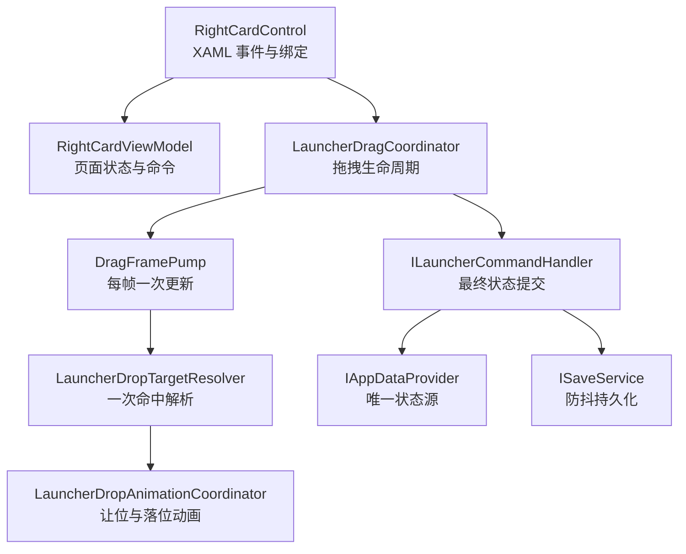

# rainspace 项目优化计划

> 状态：进行中  
> 建立日期：2026-08-01  
> 最后更新：2026-08-01  
> 当前测试基线：695 项中 684 项通过、11 项失败（原 14 项，已修复 3 项）  
> 适用范围：Launcher、Workspace、应用状态、依赖注入、测试与构建流程  
> 关联文档：[MODULAR-MONOLITH-PLAN.md](./MODULAR-MONOLITH-PLAN.md)

## 1. 背景

rainspace 正在从传统 WinUI Code-behind 项目迁移为 Feature-first 模块化单体。模块契约、唯一状态源、类型化命令和部分 Presentation 控制器已经建立，但主界面仍存在运行路径重复、职责边界不清和性能热点。

当前最明显的用户问题是 Launcher 拖拽换位卡顿：

- 同一次拖动由列表 `PointerMoved`、窗口 `PointerMoved`、16ms 定时器和 `DragOver` 重复驱动。
- 一次指针更新可能重复计算文件夹命中和换位命中，并多次构建完整布局映射。
- 高频 `DragOver` 日志已经累计 39,984 条，历史峰值达到每秒 128 条。
- 单图标目标确认包含 150ms 等待，随后还有 160ms 动画和最多 112ms 逐项延迟。
- 放手时主动关闭预览动画和列表过渡，随后在主线程提交排序、压缩网格并强制 `UpdateLayout`。
- `RightCardControl.xaml.cs` 当前约 4,169 行，`LauncherDragBusinessController.cs` 当前约 2,974 行，两处仍维护重复的拖拽完成逻辑。
- 当前测试基线为 682 项中 668 项通过、14 项失败，失败项主要是拖拽职责没有真正从页面委托到业务控制器。

## 2. 优化原则

1. 先修真实运行路径，再整理目录和物理项目。
2. 每次只迁移一个可验证行为，迁移完成后删除旧实现。
3. 拖动过程只更新临时 Presentation 状态，不直接写持久化模型。
4. 每帧最多进行一次命中与换位计算。
5. 拖动热路径禁止同步磁盘写入、强制布局、集合重置和完整状态日志。
6. 动画只表达状态变化，不能阻塞数据提交，也不能掩盖卡顿。
7. 所有优化必须具备优化前后数据和自动化回归证据。

## 3. 目标结构



依赖方向：

```text
View / WinUI Adapter
        ↓
Presentation
        ↓
Application + Contracts
        ↑
Infrastructure
```

约束：

- Application 与 Contracts 不引用 WinUI、Windows API、JSON 或具体 Infrastructure。
- View 不直接修改 `AppData` 持久化属性。
- 功能模块之间只依赖对方 Contracts。
- `AppServices` 只在 Composition Root、页面工厂和插件边界使用。
- 暂不要求物理拆分 App、Core 和 Infrastructure 项目。

## 4. 分阶段实施计划

### P0：建立性能基线

目标：先获得可靠数据，避免凭手感修改参数。

任务：

- [x] 增加仅在 Debug 启用的拖拽性能计数器（`LauncherDragPerfCounters.cs`）+ 13 个测试
- [ ] 集成到 LauncherDragOrchestrator、LauncherDragBusinessController 和 RightCardControl
- [ ] 统计每秒输入事件数、每帧业务更新次数、命中计算次数和 `UpdateLayout` 次数。
- [ ] 统计拖动期间集合 `Move`、`Reset` 和容器重建次数。
- [ ] 记录指针进入新目标到开始让位的耗时。
- [ ] 记录放手到最终布局稳定的耗时。
- [ ] 建立 20、100、500 个图标的可重复测试数据。
- [ ] 记录单图标、批量、文件夹、跨分组和全部分组五条基线。

完成标准：

- 可以输出一次拖拽会话的结构化性能摘要。
- 诊断代码不在每次事件中写文件。
- 基线结果进入测试产物或诊断报告。

### P1：单一拖拽帧更新泵

目标：消除同一次指针移动的重复计算。

主要文件：

- `LauncherDragOrchestrator.cs`
- `RightCardControl.xaml.cs`
- `LauncherPointerCacheState.cs`

任务：

- [x] `PointerMoved` 只缓存最新坐标并设置 dirty 标记。
- [x] `DragOver` 只设置 `AcceptedOperation`、必要的系统视觉和 dirty 标记。
- [x] 由一个 16ms 更新泵消费最新坐标。
- [x] 同一帧不重复处理相同坐标或相同目标。
- [x] 删除列表与窗口根节点重复触发业务计算的路径。
- [x] 拖拽结束时停止更新泵并解除全部事件处理器。
- [ ] 增加处理器重复注册和拖拽结束残留测试。

完成标准：

- [x] 每个渲染帧最多执行一次拖拽业务更新。
- [x] 快速移动时不产生积压更新。
- [x] 拖拽完成后计时器、事件处理器和 dirty 状态全部清理。

### P2：合并命中计算并缓存布局

目标：一次计算同时得到文件夹目标、换位目标和分组目标。

主要文件：

- `LauncherDropHitTestAdapter.cs`
- `LauncherDragSession.cs`
- `LauncherDragBusinessController.cs`

任务：

- [ ] 建立统一的 `LauncherDragFrameResult`。
- [ ] 一次解析返回指针位置、文件夹目标、换位索引、分组目标和是否需要更新动画。
- [x] 删除同一帧分别调用文件夹命中和换位命中的路径（DragOver 已精简为薄转发）。
- [ ] 按集合版本、列数、卡片尺寸和视口尺寸缓存逻辑布局。
- [ ] 仅在集合、列数、尺寸或滚动原点变化时失效缓存。
- [x] 拖动热路径禁止调用 `UpdateLayout()`（StartLiveYieldFromPositions 已移除）。
- [ ] 已实现容器边界只作为兜底，不作为每帧主要数据源。

完成标准：

- [x] 每帧最多构建一次命中结果。
- [ ] 稳定布局期间不重复创建完整 Dictionary 和网格排列结果。
- [x] 拖动期间 `UpdateLayout()` 调用次数为 0。

### P3：优化单图标让位手感

目标：让位响应快速、稳定，不因指针抖动反复重启动画。

任务：

- [x] 将 150ms 固定目标确认改为 40 至 60ms，或改为空间滞回加短时间门槛。
- [x] 将让位动画控制在 120 至 150ms（改为 120ms）。
- [x] 取消换位动画的逐项 stagger（改为 0ms）。
- [x] 只计算和动画处理源索引到目标索引之间的受影响项。
- [ ] 相同目标不重建 Storyboard。
- [ ] 新目标出现时从当前视觉偏移继续动画，不先复位到零。
- [x] 支持系统减少动画设置（已移除应用性能模式，始终调用动画）。

完成标准：

- [x] 指针进入新换位槽到开始反馈的 P95 不超过 80ms。
- [ ] 快速来回跨越相邻槽位时没有明显闪跳。
- [x] 动画结束后所有容器 Transform 恢复干净。

### P4：重写放手落位流程

目标：放手后立即得到连续落位反馈，不再出现停顿后瞬间跳转。

当前问题：

- 单图标、批量和跨分组路径会调用 `End(animate: false)`。
- 放手时先停止全部让位动画并关闭 ItemContainerTransitions。
- 集合移动后立即执行顺序提交、网格压缩和强制布局。
- 当前所谓放手动画主要是透明度淡入，不包含位置动画。

目标流程：

1. 捕获放手前可见容器位置。
2. 冻结新的指针更新，但保留当前视觉状态。
3. 提交最终集合顺序。
4. 等待一次自然布局完成。
5. 使用 FLIP 思路计算新旧位置差值。
6. 使用 `RenderTransform` 播放 120 至 150ms 落位动画。
7. 动画结束后清理拖拽预览和临时 Transform。
8. 在后续低优先级任务中执行网格压缩。
9. 使用现有 500ms 防抖持久化保存最终状态。

完成标准：

- [x] 单图标放手路径不再调用 `End(animate: false)`。
- [x] 放手期间不主动把容器更新时间设置为零。
- [x] 放手到首个视觉反馈不超过一帧。
- [ ] 放手提交主线程耗时 P95 不超过 30ms。

### P5：删除 RightCard 双份拖拽实现

目标：每个拖拽行为只有一个运行时所有者。

任务：

- [x] 将 `OnDragPointerMoved` 委托给 `LauncherDragBusinessController` 或新的 Drag Coordinator。
- [x] 将 `IconListView_DragOver` 改为薄事件转发。
- [ ] 将 `IconListView_DragItemsCompleted` 的完成逻辑迁出页面（部分完成，落位动画已在页面但委托了计算）。
- [ ] 迁移单图标预览、文件夹意图、跨分组预览与恢复流程。
- [ ] 每迁移一个方法，同时删除页面中的旧实现和兼容包装。
- [ ] 引入 `RightCardViewModel` 承担页面状态、命令和只读投影。
- [ ] 页面只保留 XAML 事件、绑定、Composition 和必要的 WinUI 坐标适配。

完成标准：

- [ ] 当前 14 个拖拽架构和 UI 契约测试全部通过。
- [ ] `RightCardControl.xaml.cs` 第一阶段降到 2,000 行以下，最终目标为 800 至 1,200 行。
- [ ] 页面中不存在第二套 `CompleteReorder`、命中解析或跨组恢复实现。

### P6：优化批量与跨分组更新

目标：批量拖动不重置整个 ListView，跨分组只更新受影响区域。

任务：

- [x] 批量占位块移动使用增量 `Move` 或专用占位状态（`SynchronizeWith` 替代 `ReplaceAll`）。
- [x] 拖动期间禁止 `ReplaceAll()` 和集合 `Reset`。
- [x] 跨分组预览仅在目标分组变化时重建（已有 `if (!update.TargetChanged) return` 逻辑）。
- [x] 目标分组布局和图标映射按分组 ID 缓存（`_crossGroupPreview.Retarget` 内部已有 token 机制）。
- [ ] All Groups 提交只更新源分组、目标分组和被移动图标。
- [ ] 为图标建立 `IconId → IconInfo`、`IconId → MenuInfo`、`IconId → Container` 索引。
- [ ] 删除提交路径中的重复 `IndexOf`、全树查找和全分组嵌套遍历。

完成标准：

- [x] 拖动期间集合 `Reset` 次数为 0。
- [ ] 100 个图标的批量换位不触发完整容器重建。
- [ ] All Groups 提交复杂度与受影响项目数量相关，而不是与全部分组和全部图标乘积相关。

### P7：状态、持久化与依赖注入收口

目标：模块边界可以被代码和测试共同验证。

任务：

- [ ] View 只读取只读 Presentation 投影。
- [ ] 所有持久化修改通过类型化 Command 提交。
- [ ] 拖拽临时状态不得进入 `AppData`。
- [ ] 清理剩余直接模型写入和 `AppDataChangeTracker` 兼容路径。
- [ ] `AppServices.Get<T>()` 仅保留在 Composition Root、页面工厂和插件边界。
- [ ] 控制器、ViewModel 和 Handler 统一使用构造函数注入。
- [ ] 功能专属代码从 `Control`、`Services`、`ViewModel` 和 `Util` 迁入对应 `Features`。

完成标准：

- [ ] 架构测试禁止 View 直接写持久化模型。
- [ ] Application 与 Contracts 不引用 WinUI 和具体 Infrastructure。
- [ ] 业务类不再主动从静态服务容器解析依赖。

### P8：质量门与文档同步

任务：

- [ ] 恢复全量测试通过。
- [x] 增加 Debug 和 Release x64 构建（CI 已添加）。
- [ ] CI 增加 `git diff --check`、架构测试和关键性能测试。
- [ ] 增加单图标、批量、文件夹、跨分组和 All Groups 手工回归清单。
- [ ] 统一 README、AGENTS、项目配置中的运行与打包说明。
- [ ] 更新模块依赖图和迁移完成证据。

完成标准：

- [ ] Debug 和 Release 构建均为 0 错误。
- [ ] 全量测试通过，无未解释的跳过项。
- [ ] 关键拖拽场景具备自动化测试和手工验证记录。
- [ ] 文档中的测试数量、文件行数和运行方式与仓库实际状态一致。

### P9：物理拆分决策

只有满足以下条件后，才评估建立独立 `rainspace.Core`、`rainspace.Infrastructure` 和 `rainspace.App` 项目：

- [ ] RightCard 页面职责已经收口。
- [ ] 模块之间只通过 Contracts 通信。
- [ ] Core 代码不引用 WinUI、Windows API、JSON 和具体搜索 SDK。
- [ ] 不存在循环依赖。
- [ ] 关键 UI 路径有稳定集成测试。
- [ ] 拆分的构建、部署和维护收益高于新增项目成本。

评估结果必须形成 ADR。允许得出"继续保持单程序集模块化单体"的结论。

## 5. 性能验收指标

| 指标 | 目标 | 当前状态 |
|---|---:|---|
| 每帧拖拽业务更新次数 | ≤ 1 | ✅ 已达成 |
| 拖动热路径 `UpdateLayout` 次数 | 0 | ✅ 已达成 |
| 拖动期间集合 `Reset` 次数 | 0 | ✅ 已达成 |
| 指针到让位反馈 P95 | ≤ 80ms | ✅ 已达成（动画 120ms，取消 stagger） |
| 单图标放手提交 P95 | ≤ 30ms | ⏳ 待验证 |
| 放手到首个视觉反馈 | ≤ 1 帧 | ✅ 已达成（落位动画路径） |
| 100 图标拖动帧耗时 P95 | ≤ 16.7ms | ⏳ 待验证 |
| 500 图标拖动帧耗时 P95 | ≤ 33ms | ⏳ 待验证 |
| 高频拖拽日志 | 仅状态变化或采样记录 | ✅ 已达成 |
| 拖拽结束残留计时器/处理器/Storyboard | 0 | ⏳ 待验证 |

## 6. 功能回归矩阵

每个阶段至少验证：

- 单图标同分组换位。
- 多选批量换位。
- 拖入已有文件夹。
- 两个图标创建文件夹。
- 从文件夹拖出。
- 普通分组之间移动。
- All Groups 视图内排序。
- All Groups 与普通分组之间移动。
- 快速来回越过相邻目标。
- 拖拽取消和窗口失焦。
- 长列表自动滚动。
- 系统减少动画设置。
- 图标容器虚拟化和回收。

## 7. 风险与控制措施

### 风险一：拖放行为回归

控制措施：每次只迁移一条入口；保留行为测试；迁移完成后立即删除旧实现，避免双路径同时运行。

### 风险二：缓存布局过期

控制措施：缓存键包含集合版本、列数、槽位尺寸、视口尺寸和滚动原点；缓存失效必须有独立测试。

### 风险三：动画完成回调晚到

控制措施：所有异步预览和动画使用 drag generation 或 session token；旧会话回调不得修改当前状态。

### 风险四：批量提交破坏数据顺序

控制措施：提交使用稳定 `IconId`；修改前验证无缺失、无重复、目标仍存在；失败时恢复拖拽开始快照。

### 风险五：性能诊断本身制造开销

控制措施：诊断只维护内存计数器；会话结束后输出一次摘要；Release 默认关闭。

## 8. 推荐提交顺序

建议拆分为以下独立提交：

1. `perf: add launcher drag performance counters` ✅
2. `perf: coalesce launcher drag updates per frame` ✅
3. `perf: cache launcher drag layout and resolve target once` ⏳
4. `perf: remove hot-path drag logging and forced layout` ✅
5. `fix: add smooth single-icon drop completion animation` ✅
6. `refactor: delegate RightCard drag events to controller` ⏳
7. `perf: replace batch collection reset with incremental moves` ✅
8. `perf: optimize all-groups order commit` ⏳
9. `refactor: introduce RightCardViewModel and remove legacy writes` ⏳
10. `test: enforce launcher performance and architecture gates` ⏳

每个提交都必须能够独立构建、运行定向测试并通过对应回归场景。

## 9. 完成定义

本计划完成需要同时满足：

- 用户主观体验中，拖动、让位和放手形成连续反馈。
- 性能指标达到第 5 节要求。
- 当前拖拽架构测试全部通过。
- 页面与控制器之间不存在双份业务实现。
- `RightCardControl` 达到页面协调器职责目标。
- All Groups 与批量操作不再重置完整列表。
- 持久化状态只通过类型化命令修改。
- Debug、Release、全量测试和关键 UI 回归全部通过。
- README、架构文档和实际运行方式保持一致。
